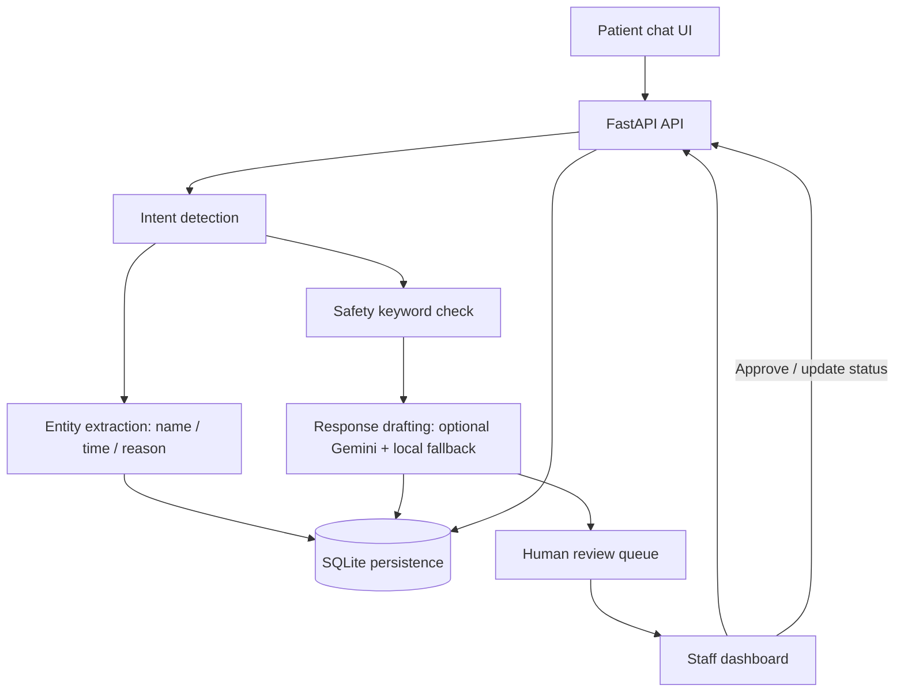

# CarePilot AI — Architecture Overview

## High-level flow

## Data model

- `appointments`: patient name (synthetic only), requested time, administrative reason, status, source, timestamps.
- `conversations`: session ID, role, message, timestamp.
- `inquiries`: source message, intent, draft response, review status, reviewed response, timestamp.

## Workflow details

1. The chat endpoint validates input and saves the patient message.
2. A transparent local classifier assigns an administrative intent and checks configured urgent keywords.
3. For booking requests, a simple extractor looks for a name and a time phrase. If both are available, a **Pending** appointment is inserted. It never claims availability or auto-confirms a slot.
4. Response generation tries Gemini when a key is configured; API failures fall back to local templates.
5. FAQ, general, incomplete booking, cancellation, rescheduling, and urgent messages create a review item (urgent messages are labelled `Urgent escalation`).
6. Staff can update appointment status or edit/approve a response. All changes persist to SQLite.

## Safety boundaries

- Administrative assistance only; no diagnosis, prescriptions, or clinical recommendations.
- Emergency-oriented language directs the user to local emergency services and creates a staff escalation record.
- Synthetic demo data only. Do not use this build with real patient information.
- AI response is labelled in the interface, and human review is explicit.

## Production gaps

Add managed PostgreSQL and migrations, authenticated user accounts, RBAC by clinic, verified patient identity, rate limiting, structured audit logs, secrets management, encryption and retention policies, stronger intent/entity models, monitoring, evaluation tests, and privacy/security review.
